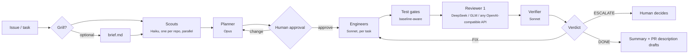

# Harness

**A multi-agent software delivery pipeline for [Claude Code](https://claude.com/claude-code), packaged as a plugin.**

Harness turns one Claude Code session into an engineering manager. It hands each part of the work to a
specialised agent: scouting, planning, implementation, an outside review by a model from a different
lab, and verification. It also enforces git guardrails and records the cost and outcome of every step,
so I can measure whether the pipeline is actually helping.

I use it daily on real projects, both single repos and multi-repo workspaces (for example an API plus
a mobile client).

---

## Why I built it

Coding agents are strong in a single session, but they don't behave like a team: they grade their own
work, run unattended near `git push`, and give you no data on what each step cost or whether it worked.
Harness is my answer to that:

- **Separation of roles.** The agent that writes the code never reviews it, and the reviewer is a model
  from a different lab (DeepSeek by default), so it's less likely to share the same blind spots.
- **Adversarial review with verification.** A second agent checks every review finding against the
  real code. It drops false positives and adjusts severities before anything goes back to the engineer.
- **Humans stay in control.** The plan needs my approval before any code is written. Agents can't push,
  rewrite history or post to GitHub. PR reviews go up only as *pending* reviews, which I submit myself.
- **Measured, not vibes.** Every stage logs tokens, cost, duration and outcome. `/harness-report`
  breaks down cost, quality and speed by stage and model, and I rate each run 1–5.

## How it works



| Stage | Agent / model | What it does |
|---|---|---|
| Grill (optional) | Manager | Interviews me about scope, edge cases and "done", then writes `brief.md` |
| Scout | `scout` / Haiku | Read-only map of the relevant code in each repo, run in parallel |
| Plan | `planner` / Opus | Writes `plan.md` and a dependency-ordered `tasks.json` |
| Checkpoint | Me | Approve, change or abort the plan |
| Implement | `engineer` / Sonnet (Opus for hard tasks) | One task at a time, runs the test gates itself |
| Review | DeepSeek (falls back to an Opus `claude-reviewer`) | Cross-lab review of the diff against the plan |
| Verify | `verifier` / Sonnet | Confirms or rejects each finding and notes anything the reviewer missed |
| Verdict | `harness.py` (deterministic) | `DONE`, `FIX` (loop back) or `ESCALATE` to me after N rounds |

The manager session only passes file paths between stages and never reads diffs or source itself,
which keeps its context small over long runs.

## Engineering highlights

- **Deterministic core, agentic edges.** Everything that shouldn't be left to an LLM (run state,
  branching, gates, cost accounting, the review-loop decision, GitHub posting) lives in a single
  ~2.9k-line Python CLI ([`scripts/harness.py`](scripts/harness.py)). It uses **only the standard
  library**, so there's nothing to install.
- **Baseline-aware test gates.** Before any edits, Harness records the failures that already exist
  (jest, pytest, Django, tsc, eslint). Gates then fail only on *new* failures, so the pipeline works on
  real codebases whose test suites aren't green.
- **Git guard hook.** A `PreToolUse` hook parses every shell command from the manager and all subagents.
  It blocks `push`, `pull`, history rewrites, commits to protected branches and GitHub write commands.
  It supports an `uncommitted` mode and a `commit` mode per project.
- **Pluggable outside reviewer.** Any OpenAI-compatible chat API works (DeepSeek, Z.ai GLM, OpenRouter).
  Cost tracking includes peak/off-peak pricing windows.
- **Cost ledger.** A `SubagentStop` hook parses each agent's transcript and prices its token usage
  (including cache reads/writes and long-context tiers). It reports API-equivalent cost on seat plans
  and real spend for outside providers.
- **Multi-repo PR review.** `/review-pr` finds linked PRs across repos, including dependency
  branches referenced in `package.json`. It reviews them together for contract mismatches and posts
  line-anchored *pending* GitHub reviews.
- **Multi-account aware.** A small shell wrapper plus a `SessionStart` hook make sure each project runs
  under the right Claude account and GitHub identity.

## Commands

| Command | |
|---|---|
| `/ship <issue or task>` | Full pipeline: optional grill, scouts, plan, approval, implementation, review loop, PR description drafts |
| `/ship --quick <task>` | No grill or scouts, one review round |
| `/review-pr <PR URL or repo#n>` | Reviews a PR plus the PRs it links to, then posts a **pending** GitHub review once I agree |
| `/harness-report` | Cost, quality and speed per stage and model |
| `/harness-init` | Set up or reconfigure the current project |

From a terminal, inside a project:

```sh
python3 scripts/harness.py doctor                   # check the setup
python3 scripts/harness.py models                   # which model each stage uses
python3 scripts/harness.py models set reviewer glm  # swap the outside reviewer
```

## Quick start

Requires [Claude Code](https://claude.com/claude-code), Python 3.11+ and the [GitHub CLI](https://cli.github.com/).

```sh
git clone https://github.com/Arbelaezch/claude-harness.git ~/code/claude-harness
claude plugin marketplace add ~/code/claude-harness
claude plugin install harness@personal-harness

export DEEPSEEK_API_KEY=...   # optional; without it, reviews fall back to a Claude reviewer

cd ~/code/my-project          # one git repo, or a folder of repos
claude
/harness-init                 # detects repos, base branches and test commands
```

`/harness-init` writes `.claude/harness.toml`, `.claude/settings.json` and a `CLAUDE.md`. Restart
`claude` afterwards and run `/ship`.

<details>
<summary><b>Optional: multiple Claude accounts</b></summary>

Add this to `~/.zshrc`:

```sh
source ~/code/claude-harness/scripts/claude-accounts.sh
```

Plain `claude` then starts with the account the project asks for in `.claude/harness.toml`
(`[accounts] claude = "work"` or `"personal"`). Each account keeps its own config directory and login
(set under `[accounts.dirs]` in `scripts/defaults.toml`). `claude-work`, `claude-personal` and
`claude-as <name>` force a specific one. To install the plugin for a second account, prefix the install
commands with `CLAUDE_CONFIG_DIR=~/.claude-personal`.

The wrapper only applies to `claude` started from a terminal. The desktop app and IDE extensions use
whatever account they're signed into, and the session-start hook warns if that doesn't match.
</details>

<details>
<summary><b>Per-project config: <code>.claude/harness.toml</code></b></summary>

- `[project]`: `name`, `description`, `review_focus` (checks that reviewers make on every review).
- `[accounts]`: `claude` (account name), `github` (gh user; the token comes from `gh auth token --user`),
  `git_email` (doctor warns when a repo commits as someone else).
- `[git]`: `base_branch`, `mode = "uncommitted" | "commit"`. Push is always blocked.
- `[repos.<name>]`: `path`, `description`, `gates = [{ name, kind, cmd, cwd }]`, where `kind` is
  jest, pytest, django, tsc or eslint.
- Any section from [`scripts/defaults.toml`](scripts/defaults.toml) can be overridden, such as
  `[reviewer]`, `[models]`, `[loop]` or `[providers.*]`.

Run state and metrics live in `.harness/` in the project, which is excluded from git automatically.
</details>

## Repository layout

```
.claude-plugin/   plugin + marketplace manifests
agents/           subagent definitions: scout, planner, engineer, claude-reviewer, verifier
skills/           slash commands: /ship, /review-pr, /harness-init, /harness-report
hooks/hooks.json  git guard, per-agent metrics, account check
scripts/          harness.py (CLI), defaults.toml, claude-accounts.sh
```

## Author

**Christian Arbelaez** · [github.com/Arbelaezch](https://github.com/Arbelaezch)
